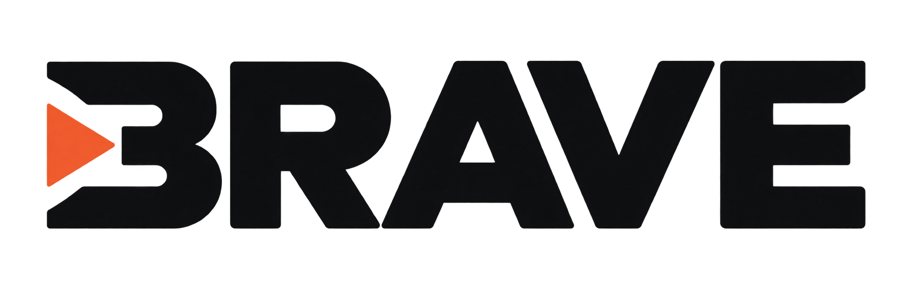

<p align="center">
  <picture>
    <source media="(prefers-color-scheme: dark)" srcset="static/brave-logo-light.png">
    
  </picture>
</p>

<h3 align="center">Brief to Reliable Agent Validation Engine</h3>

<p align="center">
  One brief and one tool API file in, one tested Freya phone agent out.
</p>

---

BRAVE is our entry for Freya's "Build the Builder" hackathon. It reads a collections brief
(markdown) and the bank's tool API (OpenAPI JSON), and publishes a validated Freya workflow
for a debt-collection phone agent. The model is used where language is needed; everything
the agent writes to the bank comes from deterministic code.

```text
brief.md + openapi.json
  → tools        parse the OpenAPI file (fields, required flags, enums)
  → spec         one model call extracts the policy; deterministic checks, one repair round
  → workflow     deterministic template: conversation, api_request, code and end_call nodes
  → validate     graph, gates (no account data before identity), turn caps, tool scope
  → Freya        dry run → save and publish → chat smoke test → export
```

The whole algorithm, stage by stage with diagrams: [`docs/brave-algorithm.html`](docs/brave-algorithm.html)
(one self-contained file; open it in a browser).

## Quick start

```bash
cp .env.example .env    # FREYA_API_KEY, OPENROUTER_API_KEY
python3 builder/build.py kit/briefs/brief-a.md kit/tools/openapi.json
```

`builder/build.py` uses only the standard library (Python 3.10+). Keys are read from the
environment, `.env`, `env.sh` or `kit/env.sh`; the environment wins. Optional:
`OPENROUTER_BASE_URL`, `BUILDER_MODEL_BUILDER` (overrides the spec model).

Each brief gets one Freya slot, named after the brief's file stem and updated in place.

### Outputs

| Path | Content |
|---|---|
| `traces/<brief>.log` | Start/end, every model call with tokens and cost, every Freya action and test |
| `submission/<brief>.spec.json` | The extracted spec |
| `submission/<brief>.workflow.json` | The platform export, or the workflow as sent if the export fails |
| `runs/<brief>/<time>/` | The previous run's trace, spec and export (moved, never overwritten) |

The trace's `END` line says how far the run got: `ok` only when the chat smoke test passed,
`ok_spec_problems` when checks were left open after the repair round (logged, the build still
publishes: an imperfect agent scores more than none), with `_smoke_failed`,
`_smoke_skipped` or `_export_failed` suffixes. A run that cannot produce a workflow ends with
`spec invalid`, `generation failed`, `invalid workflow` or `dry run refused`.

The whole run keeps to a 30-minute budget (3 minutes reserved for save and export). Freya
calls retry 5xx, 429 and dropped connections with backoff; a 4xx is an answer.

## How it works

| Stage | Module | What it does |
|---|---|---|
| Tools | `builder/fb/openapi_tools.py` | Tool definitions from the OpenAPI file, including resolved `allOf` / `$ref` responses |
| Spec | `builder/fb/spec_extract.py` | Model extraction, then `check()`, `structure()`, `grounding()` (are the values in the brief?), one repair call, deterministic overrides |
| Generator input | `to_generator()` | Engine config: bands, attempt plans, reasons, queues, lines; neutral lines where the brief is silent |
| Workflow | `builder/fb/generate.py` | Deterministic template, no model calls (design: `docs/GENERATOR.md`) |
| Code nodes | `builder/fb/nodecode/` | `negotiation_lib` (state machine), `speech_lib` (spoken dates, times, amounts, corrections), `collections_lib` (calendar, business days, bands, deadlines) |
| Validator | `builder/fb/validate.py` | Integrity, graph shape, gated tools unreachable before identity, turn caps, scope |
| Platform | `kit/freya.py` | Dry run, save, chat smoke test, export |

Design rules:

- **Deterministic skeleton around the model.** Two model calls at build time; at call time the
  model talks and classifies, code decides. Every value sent to the bank comes from a code node
  or a baked parameter.
- **Nothing hardcoded per brief.** Bands, offers, reasons and wording come from the extracted
  spec; a line the brief does not give falls back to a neutral sentence, never to another
  brief's policy.
- **Speech is parsed in code.** Spoken dates, times, amounts and dates of birth (with
  self-corrections and refused days) are read against the call's own clock.
- **Fits the platform.** `code_exec` takes 131072 bytes of code plus call data; each node
  carries only the library functions it uses, packed only above 30 KB.

## Tests

```bash
uv sync
uv run pytest tests/hack        # the builder: engine, speech, spec checks, generator, validator
make check                      # ruff + mypy + the full test suite
```

`builder/fb/harness/` runs the code-node bodies against a local mock bank with no model
(`engine_sim.py`, `bank.py`) and scores with the kit's scorer.

## Results

Recorded on the public practice set (13 customers, no partial credit: outcome, policy and
honesty must all pass):

- `builder/build.py` with the model-extracted spec: **Brief A 10/10** and **Brief B 3/3**,
  every customer 3/3 runs ([`docs/baseline-2026-10-10`](docs/baseline-2026-10-10/README.md)).
- Talkative customers (about half the messages arrive cut off): Brief A from 7/10 to 10/10,
  Brief B from 0/3 to 3/3 on three runs ([`docs/research-talkative`](docs/research-talkative/README.md)).
- 11 Oct, commit `f3d74fa`, while the platform's agent model was slow: Brief B 3/3; Brief A
  5/10, then 3 of the 5 failures passed when run again. Every call that reached its end passed.
  Each failure was the simulated customer hanging up after about 60 s of silence. The model
  steps were slow, not wrong: reading "Yes, this is Owen Park" took 4–6 minutes in some calls
  and 2–4 s in others, on the same node with the same input. In the calls that ran slow but
  did not stall, each step took 10–20 s instead of 1–2 s. Removing model steps from the
  identity turn would make it faster, but it would lose answers that come in pieces, so the
  flow is unchanged.

## Developer tools

| Tool | Use |
|---|---|
| `builder/tools/extract_spec.py <brief> <openapi> [--expect A\|B]` | Compare an extracted spec with a hand-written one |
| `builder/tools/deploy_spec.py A\|B [--slot] [--dry]` | Generate and deploy from a hand-written spec |
| `builder/tools/chat_case.py <slot> <case> "msg"...` | Talk to a saved workflow turn by turn |
| `builder/tools/call_dump.py <results.json>...` | Step-by-step timelines of simulated calls |
| `builder/tools/bank_parity.py` | Compare the local mock bank with the practice bank |
| `kit/tools/run_cases.py <agent_id> --brief A` | Run the practice customers (organizer kit) |

## Layout

| Path | Content |
|---|---|
| `builder/` | BRAVE: `build.py`, `fb/` (pipeline, code-node libraries, harness), `tools/` |
| `tests/hack/` | Builder tests and spec fixtures |
| `kit/` | Organizer kit: briefs, tool API, practice customers, Freya client, scorer |
| `docs/` | Generator design, baselines, research notes |
| `static/` | Logos |
| `src/builder/`, `examples/`, `scripts/` | Earlier generic pipeline, not used by `builder/build.py` |
